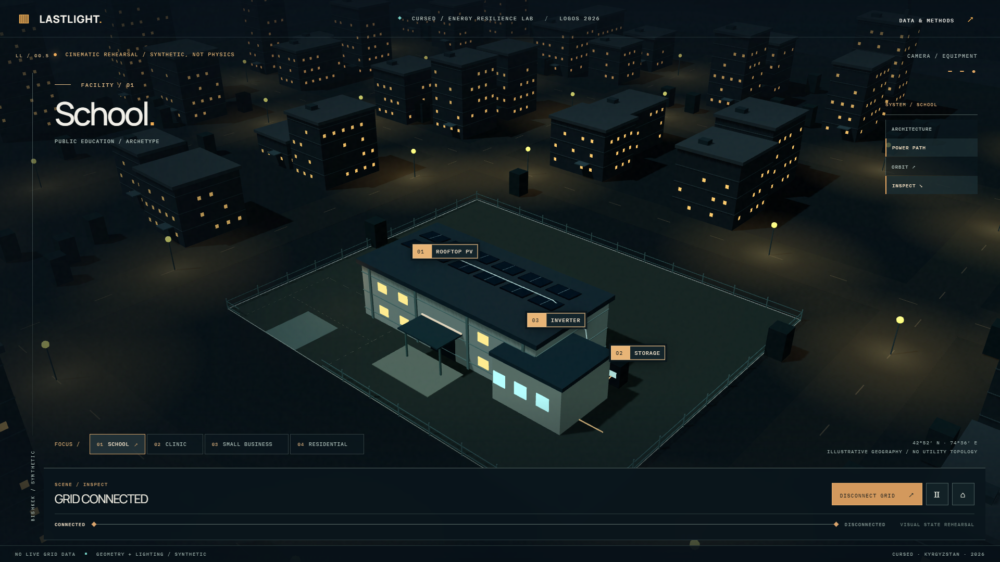

# LASTLIGHT

An interactive energy resilience digital twin by CURSED, Kyrgyzstan.

LASTLIGHT explores how a building's local energy system might respond when the grid goes down. The current release is a cinematic, interactive prototype for the LOGOS Hackathon 2026 final.



## Experience

Fly into a synthetic night district, select the school, inspect its solar panels, inverter and battery, disconnect the grid, then reset the scene. The camera stays inside one modeled world throughout the journey. Lighting and the visible power path respond to the outage control.

The grid outage is a **visual rehearsal**. There is no validated energy dispatch, measured meter data or live utility connection in this release. The interface identifies synthetic states directly.

## Run locally

Use Node.js 20.19 or newer.

```sh
cd apps/web
npm ci
npm run dev
```

Open the address printed by Vite. Chrome is required for local browser tests.

## Verify

From the repository root:

```sh
npm run build
npm run lint
npm run test:smoke
```

The browser suite covers the camera journey, facility selection, view layers, outage, reset, reduced motion and projector resolution. GitHub Actions runs the same build and interaction checks with Chromium.

See the [visual review](evidence/phase-00.5/README.md), [1440 x 900 opening](evidence/phase-00.5/opening.png), [1920 x 1080 outage](evidence/phase-00.5/offline-1920x1080.png) and [recorded interaction](evidence/phase-00.5/interaction-demo.webm).

## Repository

- `apps/web`: React, TypeScript, Vite and React Three Fiber application.
- `apps/web/tests`: Playwright browser checks.
- `docs/PRODUCT.md`: audience, experience and current claims.
- `docs/ENGINEERING.md`: the physics contract and a reference calculation.
- `evidence/phase-00.5`: actual browser screenshots, video and review notes.
- `reference/legacy-physics`: archived energy balance research and unit tests, not part of the running app.

The next engineering milestone is a validated simulation trace. All figures and visual states that describe physical performance must come from that same trace. See the [change log](CHANGELOG.md) for the project's development path.
