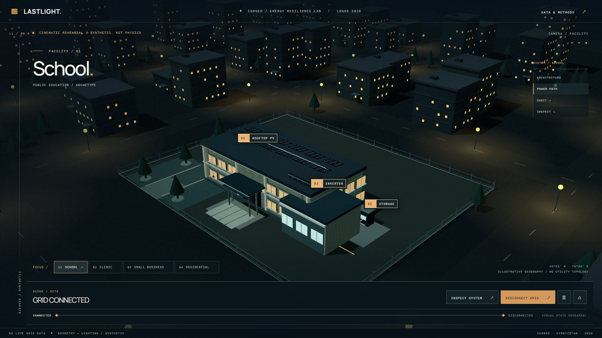

# LASTLIGHT

An interactive energy resilience digital twin by CURSED, Kyrgyzstan. This release candidate brings the cinematic district and the official Physics API together for the LOGOS Hackathon 2026 final.



## Experience

Fly into a synthetic night district and inspect four facilities. Clinic, small business and the three-block residential parcel are visual site studies. They have no validated energy model and no outage control.

The school runs the official deterministic single-bus Physics API with synthetic inputs. Disconnect the grid, play the trace, inspect the first critical failure at 9.12 hours, compare a 36 kWh battery that sustains the 12-hour window, and explore the physics-verified Failure Frontier. The frontend can replay frozen official results when the API is offline. Live calculation and offline replay are labeled separately. No measured site data or live utility connection is claimed.

## Run locally

Use Python 3.12 and Node.js 20.19 or newer. From the repository root, open two PowerShell terminals.

Terminal 1, official Physics API:

```powershell
.\services\simulation\start.cmd
```

Terminal 2, website:

```powershell
cd apps/web
npm ci
npm run dev
```

Open the local address printed by Vite. To present without the API, open that address with `?demo=offline`. The page will use the checked-in official results and label them `VERIFIED OFFLINE REPLAY`. The first API installation needs package access. After it is installed, `start.cmd --offline` restarts it without the package index.

## Verify

```powershell
cd apps/web
npm run build
npm run lint
npm run test:smoke
```

From the repository root, after the API environment is installed:

```powershell
.\services\simulation\.venv\Scripts\python.exe -m services.simulation.check
```

The Physics API workflow runs this production suite plus a fresh HTTP launcher and offline restart on Ubuntu and Windows. [Release review](evidence/phase-04/README.md) records the integration decisions, visual evidence and exact test results.

## Repository

- `apps/web`: React, TypeScript, Vite and React Three Fiber application.
- `services/simulation`: official Physics API v1 and bounded physical Failure Frontier.
- `tests/simulation`: engine, contract, API, frontier and launcher checks.
- `apps/web/tests`: Playwright browser checks.
- `docs/physics`: model, numerical contract, frozen inputs and results.
- `evidence/phase-04`: current screenshots, layout measurements and browser walkthrough.
- `reference/legacy-physics`: archived research, outside the running app.

See the [change log](CHANGELOG.md) for the project's development path. The public interface uses official physical results only for the school. The incompatible PR #7 checkpoint stays isolated. This branch integrates verified official-v1 FragilityNet models and a separate historical EnergyDNA preview; see the [unified intelligence guide](docs/unified/README.md), [judge overview](docs/unified/OVERVIEW.md) and [two-minute demonstration](docs/unified/DEMO_SCRIPT.md). Physics remains authoritative and works without optional neural packages.

Team contributions follow the [branch and review workflow](CONTRIBUTING.md). Work items and progress belong in GitHub Issues and pull requests.
