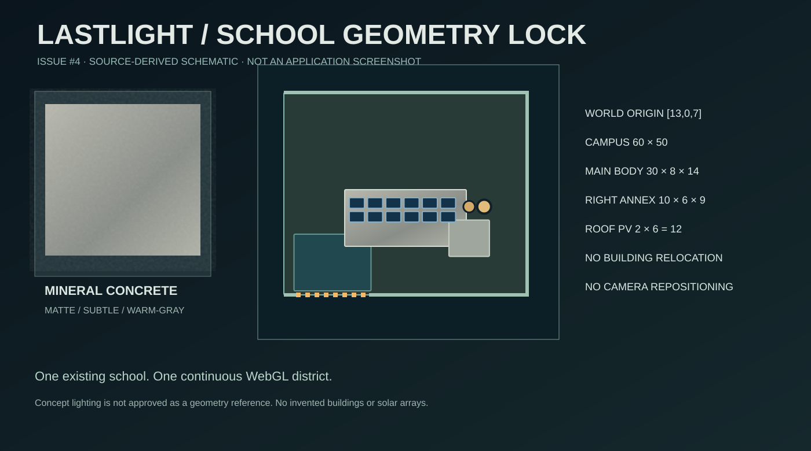
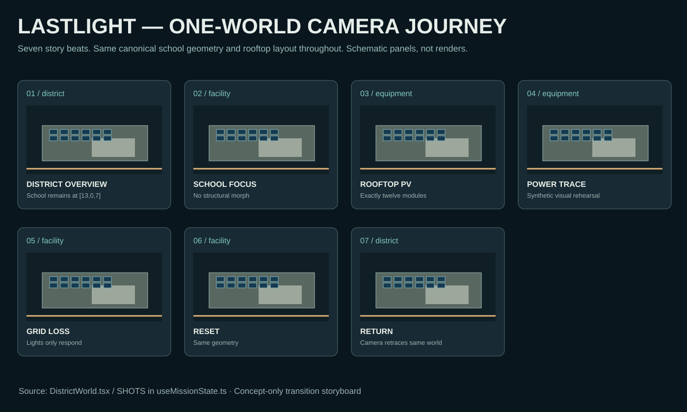

# LASTLIGHT — Issue #4 Visual Handoff (review branch)

**Real GitHub submission:** Source-anchored facade material candidate, three GitHub-hosted tileable procedural PBR PNG maps, the original layout continuity specification, and one-world seven-shot storyboard.

## Baseline: real original WebGL capture

This is a real baseline capture committed earlier by the team; do not confuse it with the source-derived SVG boards above. A same-pose *candidate* screenshot must still be produced by Abai after checking out this PR.

## Current implementation in this PR

- `apps/web/src/scene/DistrictWorld.tsx` changes ONLY one import and replaces two school wall-material JSX nodes with `SchoolFacadeWall`; all other geometry and energy-state code remains identical.
- `apps/web/src/scene/SchoolFacadeWall.tsx` has original local wall transforms, per-face integer-repeat UVs and Suspense fallback.
- `apps/web/public/assets/materials/facade02` contains three 1024×1024 procedural, seam-aligned PBR-like maps: sRGB basecolor, linear roughness, OpenGL tangent normal.
- This directory contains source-lock specifications and visual review artifacts. These SVG illustrations are *schematic*, not actual WebGL captures.

**Important provenance:** An earlier independently generated 34 MB ChatGPT Visual Kit, including cinematic concept PNGs, was prepared for this issue; its original PNG binaries are **not present in this PR**. The PNG maps here are a new deterministic procedural substitute made for direct GitHub review and are NOT the originals. Do not present this PR as publishing *all* original creative assets. The original package is still supplied in the ChatGPT conversation.

**Review before merge:** No live in-app build/test has been run in this chat environment (GitHub connector access only). Abai should inspect the PR in real Chrome/WebGL and run build/lint/smoke before merging. Leave Issue #4 open until live screenshot-locked approval.

Full checklist: [Continuity and QA](CONTINUITY_AND_QA.md).

Issue: [#4](https://github.com/pablo228sos/lastlight/issues/4)
