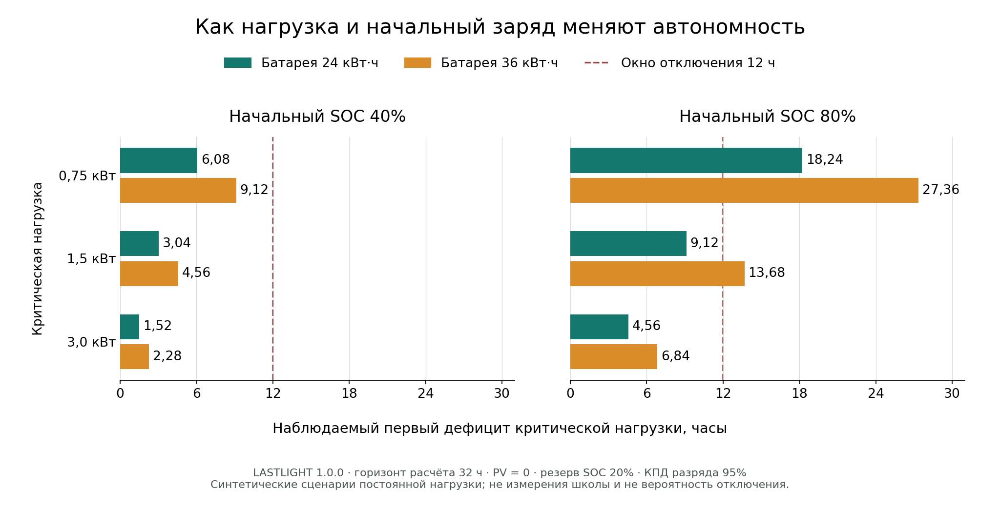

# Воспроизводимое исследование чувствительности

Проверено 24.10.2026. Численный источник — **неизменённый официальный PR6**,
commit `ef23a710ecb7b235ea734171730a4656c40f4615`, модель
`lastlight-dispatch-1.0.0`, schema `1.0.0`. Python 3.12.14,
Pydantic 2.14.1. Это синтетические инженерные сценарии, не полевые измерения,
не статистическая выборка отключений и не результат ML.

## Дизайн опыта

Полный небольшой факторный набор: C = 24/36 кВт·ч × SOC0 = 40/80% ×
Pcritical = 0,75/1,5/3 кВт — **12 конфигураций**. Каждая рассчитана на горизонтах
12 и 32 часа. 12 часов отвечает демонстрационной задаче; 32 часа длиннее
максимальной автономности выбранного набора (27,36 ч), поэтому во всех 12 длинных
запусках наблюдается событие отказа. Нельзя заменять null короткого запуска
временем из формулы или длинного запуска.

Основной шаг — 15 минут. Повторение при 1 и 60 минутах проверяет, что событие
разделяет реальный интервал, а не округляется к сетке. 12×2×3 = 72 результата;
ещё 3 проверки горизонта ровно 9,12 ч при шагах 1/15/60 дают **75 результатов**.
Это 24 основные строки, 48 проверок шага и 3 boundary-check, а не 75 независимых
натурных испытаний. Все проверки пройдены.

Общие входы: reserve SOC 20%, maximum SOC 100%, ηdis = 95%, PV/grid = 0,
инвертор и max discharge по 8 кВт, noncritical = 2 кВт и shedding=true.
Остальные значения — разрешённые defaults schema, записанные полностью
в `input_json` каждой CSV-строки; seed = 0, synthetic provenance.
Ни одна исследуемая critical-нагрузка не достигает предела 8 кВт.
Дата старта — фиксированная дата синтетического запроса, не время наблюдения школы.

## Результаты

Время — **наблюдаемое первое critical shortfall в соответствующем запуске**.
`null` = событие не наблюдалось внутри [start, end); это не бесконечный резерв.
Unserved и конечный SOC ниже относятся только к 12-часовому запуску.

| C, кВт·ч | SOC0, % | Pcritical, кВт | Отказ при H=32, ч | Отказ при H=12, ч | Выживает 12 ч | Critical unserved за 12 ч, кВт·ч | SOC в конце 12 ч, % |
| --- | --- | --- | --- | --- | --- | --- | --- |
| 24 | 40 | 0,75 | 6,08 | 6,08 | нет | 4,44 | 20,00 |
| 24 | 40 | 1,5 | 3,04 | 3,04 | нет | 13,44 | 20,00 |
| 24 | 40 | 3 | 1,52 | 1,52 | нет | 31,44 | 20,00 |
| 24 | 80 | 0,75 | 18,24 | null | да | 0,00 | 40,53 |
| 24 | 80 | 1,5 | 9,12 | 9,12 | нет | 4,32 | 20,00 |
| 24 | 80 | 3 | 4,56 | 4,56 | нет | 22,32 | 20,00 |
| 36 | 40 | 0,75 | 9,12 | 9,12 | нет | 2,16 | 20,00 |
| 36 | 40 | 1,5 | 4,56 | 4,56 | нет | 11,16 | 20,00 |
| 36 | 40 | 3 | 2,28 | 2,28 | нет | 29,16 | 20,00 |
| 36 | 80 | 0,75 | 27,36 | null | да | 0,00 | 53,68 |
| 36 | 80 | 1,5 | 13,68 | null | да | 0,00 | 27,37 |
| 36 | 80 | 3 | 6,84 | 6,84 | нет | 15,48 | 20,00 |

Округление таблицы — 2 знака; CSV хранит 12 значащих цифр, полные входы,
UTC события, `run_id`, `input_hash`, версии и команду каждой строки.
[CSV](data/sensitivity_results.csv), [manifest](data/sensitivity_manifest.json),
[PNG для презентации](figures/sensitivity_autonomy_ru.png),
[SVG](figures/sensitivity_autonomy_ru.svg).



### Что следует из опыта

- Эталон 24 кВт·ч / 80% / 1,5 кВт: отказ **9,12 ч**, critical unserved
  **4,32 кВт·ч** к 12 ч, конечный SOC 20%.
- 36 кВт·ч при тех же условиях: **нет наблюдаемого отказа за 12 ч**, critical
  unserved = 0, конечный SOC ≈27,37%. **13,68 ч наблюдаются в отдельном
  32-часовом запуске**; это также совпадает с независимой аналитической оценкой.
- Увеличение C на 50% даёт +50% времени только в этих случаях без ограничений
  мощности, PV и переменных нагрузок. Это не универсальная гарантия установки.
- При резерве 20% переход SOC0 40→80% **утраивает** доступную энергию
  (20→60% номинала), а не удваивает её. 36 кВт·ч при 40% и 1,5 кВт дают
  4,56 ч — меньше, чем 24 кВт·ч при 80% (9,12 ч).
- Рост нагрузки 0,75→3 кВт сокращает время в четыре раза при прочих равных.
  Только **3 из 12 выбранных конфигураций** покрывают 12 ч. Это доля дизайн-точек,
  не вероятность отключения, надёжности или успеха среди реальных школ.

## Независимая проверка и граница окна

Для постоянного случая, когда мощности достаточно:

`Eavailable_AC = C × (SOC0 − SOCmin) × ηdis`

`tau_analytic = Eavailable_AC / Pcritical`

`unserved_critical = max(0, Pcritical × H − Eavailable_AC)`

Формула используется **только как независимая проверка** уже полученного engine
result. В CSV время события берётся из `summary.critical_survival_hours`, а не
из `tau_analytic`. Проверены также UTC первого события, сумма реальных длительностей
trace, конечный SOC, потери и энергобаланс каждого интервала.
Максимальный абсолютный interval residual в наборе — 3.13e-13 кВт·ч;
допуск проверки <1e-8 кВт·ч. Нулевой numerical residual не доказывает точность
модели на реальном объекте.

При H ровно 9,12 ч официальный engine во всех трёх шагах возвращает null и
survival=true: положительного интервала после истощения в окне нет.
Исследовательский [аудит PR7](data/repository_evidence_audit.json) отдельно
воспроизводит конфликт: при шагах 1/15 минут его версия сообщает отказ на правой
границе из-за остатка порядка 1e-13/1e-14 кВт·ч. Этот кандидат не использовался
как численный источник исследования.

## Воспроизведение

Из checkout исследовательской ветки, рядом с pinned checkout `../lastlight-physics`:

```bash
../lastlight-physics/services/simulation/.venv/bin/python research/engineering_evidence/run_sensitivity.py --engine-root ../lastlight-physics --check
../lastlight-physics/services/simulation/.venv/bin/python research/engineering_evidence/run_sensitivity.py --engine-root ../lastlight-physics --case-id c36-soc80-p1.5-h12-m15
python research/engineering_evidence/plot_sensitivity.py
```

Вторая команда печатает **полный engine JSON**, не только CSV-строку.
Построение графика требует отдельного research plotting environment;
[README с установкой, Windows-синтаксисом и всеми командами](../../research/engineering_evidence/README.md).
Первый запуск без `--check` пересоздаёт CSV/manifest, `--check` пересчитывает
все случаи и требует совпадения файлов. SHA-256 исходников не даёт незаметно
подменить официальный engine. [Pin](../../research/engineering_evidence/engine_pin.json).

## Что исследование не проверяет

Нет погодного ряда, температур, батарейного старения, пусковых токов,
реактивной мощности, случайных отказов, затрат или реальных школьных профилей.
32 часа — диагностический горизонт, не прогноз продолжительности аварии.
Солнечный сценарий сознательно не добавлен: ни один результат не выдаёт
гипотетическую генерацию за погоду Кыргызстана. Полевая применимость входов
разобрана в [ENGINEERING_ASSUMPTIONS.md](ENGINEERING_ASSUMPTIONS.md).
